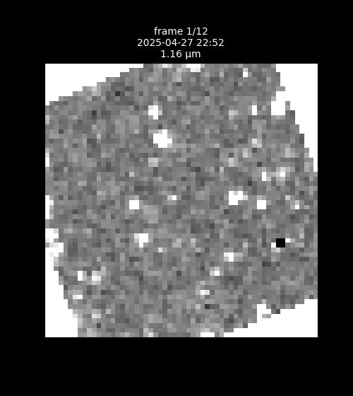

# Time Explorer

**Watch the infrared sky change. Find what moves.**

Type a position on the sky (Right Ascension and Declination) and this tool plays every image NASA's **SPHEREx** telescope has taken of that patch, in time order, like a flipbook. Stars and galaxies stay put. Asteroids and comets drift. Anything that changes stands out, and the tool tells you whether it's already known.


<p align="center">
  
</p>

---

## Contents
- [Features](#features)
- [Quick start (Windows)](#quick-start-windows)
- [Manual setup (any OS)](#manual-setup-any-os)
- [Using it](#using-it)
- [How it works](#how-it-works)
- [API](#api)
- [Configuration](#configuration)
- [Deploying](#deploying)
- [Project layout](#project-layout)
- [Tests](#tests)
- [Limits](#limits)
- [Data credits](#data-credits)

## Features
- **Play mode**: step through every SPHEREx frame of a spot. The timeline is coloured by the infrared wavelength each frame saw and grouped into visits.
- **Compare mode**: before / after / difference panels. Frames are paired at the same wavelength, so differences are real changes rather than colour effects. Red means brighter now; blue means brighter before.
- **"Is it known?" overlays**:
  - Orange rings: catalogued asteroids and comets at the exact time of each frame (IMCCE SkyBoT).
  - Blue rings: Gaia stars (the 150 brightest in view).
  - Red boxes: **candidates**, meaning changes no catalogue explains.
- **Click anything** to see its position, brightness and quality flags, plus a **spectrum** built from every visit. SPHEREx sees a spot at a different wavelength each time, so the visits together form a spectrum.
- **Shareable URLs**: the address bar holds the position, field size, mode and frame, e.g. `/?ra=150&dec=2.2&fov=0.1&mode=compare`.
- **Demo spots**: asteroids Abundantia, Menzel and De Sitter caught moving, plus the quiet COSMOS deep field.
- **Always up to date**: the archive is queried live, so new SPHEREx releases appear without code changes.

## Quick start (Windows)
1. Install **Python 3.10+** (3.12 recommended) from [python.org](https://www.python.org/downloads/). Tick **"Add python.exe to PATH"** in the installer.
2. Download this repo (green **Code** button → *Download ZIP*, or `git clone`).
3. Double-click **`setup.bat`**. It creates a private Python environment in `.venv` and installs everything. You only do this once.
4. Double-click **`start.bat`**. Your browser opens at http://localhost:8000.

To stop the app, close the `start.bat` window.

## Manual setup (any OS)
```bash
git clone https://github.com/zohaiblazuli/noctilith.git
cd noctilith
python -m venv .venv
# Windows:      .venv\Scripts\activate
# macOS/Linux:  source .venv/bin/activate
pip install -r requirements.txt
python -m uvicorn server.app:app --port 8000
```
Then open http://localhost:8000.

**Before a live demo**, warm the cache so nothing waits on the network:
```bash
python scripts/precache.py                 # all demo spots
python scripts/precache.py --only Menzel   # just one
```

## Using it
1. Type RA and Dec in degrees (e.g. `150`, `2.2`) or pick **Try a demo spot…**.
2. Frames stream in; grey tiles on the timeline are still loading, and clicking one retries it.
3. Press **Play** to flip through time, or switch to **Compare** to see what changed.
4. Toggle the overlays to check whether a moving or changing object is already catalogued.
5. Click a source to open its details and spectrum.

The first visit to a new spot downloads its images (roughly 1–2 frames per second on a ~3 MB/s connection; a spot can have ~240 frames). After that they load instantly from the local `cache/` folder.

## How it works
```
browser (web/)  ──►  FastAPI (server/)  ──►  IRSA SIA: which SPHEREx images cover this spot?
   canvas flipbook          │            ──►  NASA AWS mirror: byte-range reads of only the needed pixels
                            │                  (IRSA cutout service as fallback)
                            │            ──►  SkyBoT: known asteroids/comets at each frame's time
                            │            ──►  ESA Gaia archive: known stars
                            └──  cache/  (reprojected frames, saved to disk)
```
- **Finding images**: the server asks the NASA/IPAC Infrared Science Archive (IRSA) which SPHEREx images cover the spot, then groups them into visits.
- **Fetching pixels**: it reads just the rows it needs from NASA's public AWS copy of the data (12 requests in parallel, with retries), falling back to IRSA's cutout service.
- **Lining up**: every frame is reprojected north-up onto one shared grid with `astropy` and `reproject`, and bad pixels are masked using the quality flags.
- **Frontend**: plain HTML/JS with no build step, drawing frames on `<canvas>`.

## API
All endpoints take `ra`, `dec` (degrees) and `fov` (field of view in degrees, 0.02–0.5, default 0.1).

| Endpoint | Returns |
|---|---|
| `GET /api/frames` | Every SPHEREx frame covering the spot, grouped into visits |
| `GET /api/frame?id=…` | One reprojected frame (pixels + mask) |
| `GET /api/known/sso?mjd=…` | Known asteroids and comets in view at that time (SkyBoT) |
| `GET /api/known/stars` | Gaia stars in view |

Interactive docs are at http://localhost:8000/docs while the server is running.

## Configuration
Any setting in [`server/config.py`](server/config.py) can be overridden with an environment variable named `SPHEREX_<FIELD>`:

| Variable | Default | Meaning |
|---|---|---|
| `SPHEREX_COLLECTION` | `spherex_dr1,spherex_qr3` | Comma-separated IRSA collections to search (add new releases here; old names stop working when IRSA retires them) |
| `SPHEREX_CACHE_DIR` | `cache` | Where downloaded frames are stored |
| `SPHEREX_MAX_CONCURRENCY` | `12` | Parallel downloads |
| `SPHEREX_FOV_DEFAULT` | `0.1` | Default field of view (degrees) |

## Deploying
A `Dockerfile` is included. It serves the app on port 7860 and works on any Docker host or a Hugging Face Space:
```bash
docker build -t spherex-time-explorer .
docker run -p 7860:7860 spherex-time-explorer
```
`scripts/deploy_hf.sh <user>/<space>` pushes a clean code-only snapshot to a Hugging Face Space. Hosting in the US, near NASA's data, makes new spots load much faster.

## Project layout
```
server/    FastAPI backend: archive search, frame fetching, reprojection, cache, known objects
web/       Frontend (index.html + plain JS modules, no build step)
scripts/   precache.py, find_demo_spots.py, deploy_hf.sh
tests/     pytest suite (+ small FITS fixtures)
docs/      Status, decisions log, verified research notes, design spec and plan
recon/     Early exploration scripts and sample renders
setup.bat  One-time Windows setup     start.bat  Launch the app
```

## Tests
```bash
python -m pytest -q          # backend (40 tests)
node --test "web/*.test.mjs" # frontend logic (21 tests, needs Node 18+)
```

## Limits
- **A candidate is not a discovery.** Many are faint galaxies, noise or detector glitches. Check several frames and the quality flags.
- Asteroid positions are straight-line extrapolations within about a day, from a geocentric SkyBoT query. SPHEREx orbits Earth, which shifts very close asteroids slightly.
- Pixels are 6.15″, so this is a survey telescope, not a zoom lens.
- A brand-new spot takes a couple of minutes to load fully on a slow connection. Pre-cache spots you plan to show.

## Data credits
- SPHEREx data: NASA/JPL-Caltech, via the NASA/IPAC Infrared Science Archive (Quick Release QR2) and the NASA Open Data registry on AWS.
- Known solar-system objects: IMCCE SkyBoT.
- Stars: ESA Gaia DR3 (gea.esac.esa.int).
